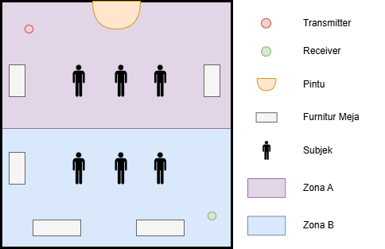
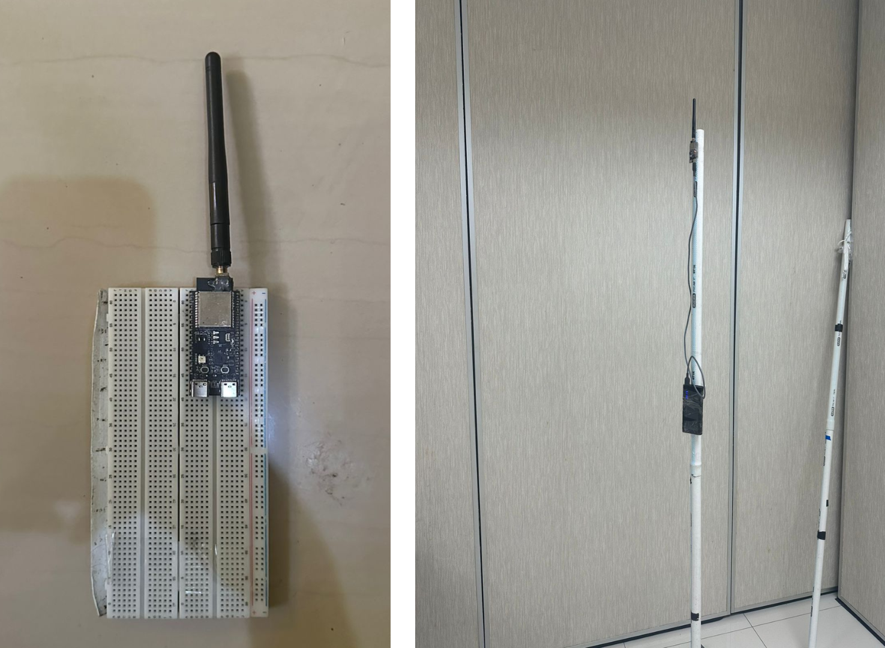

# CSI data collection firmware: thesis and conference paper

[Versi Bahasa Indonesia](README.md)

Firmware and recording tools for collecting Wi-Fi 6 Channel State Information (CSI) with two ESP32-C6 boards. The data is used to estimate the number of people in a room, from 0 to 6.

The acquisition method is **UART (v2)**: the receiver sends CSI over UART to a PC, and a Python script stores it as `.bin` files.

## Folder contents

```text
firmware-skripsi-conference/
├── transmitter/                 ESP-IDF project, 100 Hz ESP-NOW transmitter
├── receiver/                    ESP-IDF project, CSI receiver with binary UART stream
├── tools/
│   ├── csi_uart_capture.py      Records the UART stream to a .bin file
│   └── csi_bin_to_csv.py        Converts a .bin file to .csv
└── docs/                        Layout and hardware figures
```

## How it works

```text
Transmitter ── ESP-NOW broadcast, 100 Hz ──> Receiver ── UART 921600 ──> USB-TTL ──> PC
```

1. The transmitter sends a 4-byte counter to the broadcast address every 10 ms.
2. The receiver captures CSI from every packet that comes from the transmitter's MAC.
3. The receiver builds a 28-byte header plus 512 CSI values and writes them to UART0.
4. About once per second, the receiver inserts the magic value `0xDEADBEEF` as a sync marker.
5. `csi_uart_capture.py` waits for the first magic, then saves every byte to a file.

## Requirements

### Hardware

| Item | Quantity | Notes |
|---|---|---|
| ESP32-C6-DevKitC-1-N8 | 2 | One transmitter, one receiver |
| 2.4 GHz 3 dBi omnidirectional antenna | 2 | External antenna, replaces the onboard PCB antenna |
| USB-TTL adapter | 1 | 3.3 V logic, supports 921600 baud |
| Power bank | 2 | Powers both boards |
| 2 m support pole | 2 | One per board |
| PC | 1 | Runs the recorder |

### Software

- ESP-IDF 5.5.2
- Python 3 and pyserial

```bash
pip install pyserial
```

The `esp_csi_gain_ctrl` component is downloaded automatically during the first build, so that build needs internet access. Its version is pinned in `dependencies.lock`.

## Radio configuration

| Parameter | Value |
|---|---|
| Target | ESP32-C6 |
| Channel, bandwidth | 11 (2.4 GHz), 20 MHz |
| Protocol | IEEE 802.11ax, ESP-NOW HE20, MCS0 long GI |
| Transmit rate | 100 packets per second |
| Destination | Broadcast `ff:ff:ff:ff:ff:ff` |
| Transmitter MAC | `1a:00:00:00:00:00` |
| Transmit power | Setting 84 (21 dBm) |
| CSI mode | HE SU, 256 subcarriers, 242 active |
| UART | UART0, GPIO16/17, 921600 baud, 8N1 |

## Build and flash

Activate the ESP-IDF environment first.

```powershell
. C:\esp\v5.5.2\esp-idf\export.ps1
```

Run these commands in the `transmitter` folder, then repeat them in the `receiver` folder. Replace `COM5` with the board's port.

```bash
idf.py set-target esp32c6
```

```bash
idf.py build
```

```bash
idf.py -p COM5 flash
```

Both projects were build-tested from a clean state on ESP-IDF 5.5.2. These builds have not been re-tested on hardware.

### Checking the transmitter

```bash
idf.py -p COM5 monitor
```

A healthy transmitter prints `===== ESP-NOW Broadcast Only =====`, then `Last sent id: <number>` every second.

The receiver prints no logs at all. The firmware disables logging because UART carries binary data, so check the receiver through the recorder.

## Wiring the receiver

| USB-TTL adapter | ESP32-C6 (receiver) |
|---|---|
| RXD | GPIO16 |
| TXD | GPIO17 (optional, the receiver takes no commands) |
| GND | GND |

Leave the adapter's VCC pin unconnected, because the board is powered by the power bank.

The stream leaves through GPIO16, not the board's USB-JTAG port. Recording from the USB-JTAG port gives 0 bytes.

## Placing the devices



- The room measures 7 × 9 m and is split along its 9 m side into Zone A and Zone B, each 7 × 4.5 m.
- Both zones contain desks as furniture.
- The transmitter sits in the top-left corner of Zone A.
- The receiver sits in the bottom-right corner of Zone B.
- They are about 10–11 m apart along the diagonal.
- Both boards are mounted on top of 2 m poles.



## Data collection protocol

Six people took part: the researcher and five volunteers. Each subject stays inside the assigned zone during a recording.

### Class 0: empty room

Record for 3 minutes with no subjects, in four furniture configurations:

1. No chairs
2. 2 chairs
3. 4 chairs
4. 8 chairs

### Classes 1 to 6

Each class of n people is recorded in every zone distribution: Zone A only, Zone B only, and all cross-zone combinations. Each distribution is recorded in two scenarios.

| Scenario | Duration | Minute 1 | Minute 2 | Minute 3 |
|---|---|---|---|---|
| `Berdiri_Aktivitas` (standing, active) | 3 minutes | Everyone stands still | Half of the subjects walk randomly in their zone, the rest stand still | Everyone walks randomly in their zone |
| `Duduk_Cluster` (seated, clustered) | 2 minutes | Everyone sits spread out in their zone | Everyone sits clustered at the center of their zone | None |

### Number of recordings

| Class | Variants | Files |
|---|---|---|
| 0 | 4 furniture configurations | 4 |
| 1 | A, B | 4 |
| 2 | A, B, AB 1-1 | 6 |
| 3 | A, B, AB 1-2, 2-1 | 8 |
| 4 | A, B, AB 1-3, 2-2, 3-1 | 10 |
| 5 | A, B, AB 1-4, 2-3, 3-2, 4-1 | 12 |
| 6 | A, B, AB 1-5, 2-4, 3-3, 4-2, 5-1 | 14 |
| **Total** | | **58** |

### File naming

| Pattern | Meaning | Example |
|---|---|---|
| `0orang_<a-d>.bin` | Empty room | `0orang_a.bin` |
| `A_<n>orang_<scenario>.bin` | n people in Zone A | `A_3orang_Berdiri_Aktivitas.bin` |
| `B_<n>orang_<scenario>.bin` | n people in Zone B | `B_2orang_Duduk_Cluster.bin` |
| `AB_<x>-<y>orang_<scenario>.bin` | x people in Zone A, y people in Zone B | `AB_2-1orang_Berdiri_Aktivitas.bin` |

`orang` means people. Labels are read from the file name, so a wrong name produces a wrong label.

## Recording steps

### Before a session

1. Mount both boards on their poles at their positions.
2. Power the transmitter from a power bank. Leave it on for the whole session.
3. Power the receiver from a power bank, then connect the USB-TTL adapter to the PC.
4. Find the adapter's port name, such as `COM7` on Windows or `/dev/ttyUSB0` on Linux.
5. Create the recording folder inside this folder.

```bash
mkdir captures
```

6. Make a 10-second test recording, then check it as described in [Checking a recording](#checking-a-recording).

```bash
python tools/csi_uart_capture.py COM7 -b 921600 -o captures/test.bin --duration 10
```

### For each recording

1. Arrange the furniture and subjects for the class, zone, and scenario.
2. Start the recorder with a correctly formatted file name.

```bash
python tools/csi_uart_capture.py COM7 -b 921600 -o captures/A_2orang_Berdiri_Aktivitas.bin --duration 200
```

3. Confirm that the log grows by about 92 KB every second.

```text
saved=92160 bytes | elapsed=1.0s
saved=184320 bytes | elapsed=2.0s
```

4. Guide the phase changes every minute according to the scenario.
5. The recorder stops by itself after `--duration`. You can also stop it with `Ctrl+C`.
6. Check the file, then move on to the next recording.

The recorder discards the receiver's boot text before the first magic.

### Choosing a duration

The training parser drops the first 500 and last 500 packets of a recording, about 6 seconds on each side. Add a margin so that scenario phases are not lost.

| Recording | Scenario duration | Suggested `--duration` |
|---|---|---|
| Class 0 | 180 seconds | 190 |
| `Berdiri_Aktivitas` | 180 seconds | 200 |
| `Duduk_Cluster` | 120 seconds | 150 |

These suggestions follow the dataset's typical values. Recordings were originally started and stopped by hand, so file durations in the dataset vary: about 179–189 seconds for class 0, 136–221 seconds for `Berdiri_Aktivitas`, and 121–199 seconds for `Duduk_Cluster`.

## Checking a recording

```bash
python tools/csi_bin_to_csv.py captures/A_2orang_Berdiri_Aktivitas.bin
```

This creates a `.csv` file next to the `.bin` file and prints a summary such as `Done. rows=15676, magic=173, bad_records=0`.

| Column | Expected value |
|---|---|
| `tx_id` | 4 |
| `mac` | `1a:00:00:00:00:00` |
| `channel` | 11 |
| `len` | 512 |
| `sig_len` | 47 |

Expect about 87.5 rows per second and about 1 magic per second. `bad_records` should ideally be 0.

### Troubleshooting

| Symptom | Likely cause | What to check |
|---|---|---|
| Log stays at `saved=0` | The stream is not reaching the PC | GPIO16 to RXD wiring, GND, port, and baud |
| Log stays at `saved=0` | The board's USB-JTAG port was opened | Use the USB-TTL adapter's port |
| Log grows far below 92 KB per second | Transmitter is off or too far away | Transmitter monitor, antenna position, and channel |
| `Missing dependency: pyserial` | pyserial is not installed | Run `pip install pyserial` |
| `Failed to open serial port` | Wrong port, or the port is in use | Close other serial monitors |
| `No such file or directory` | The output folder does not exist | Create the `captures` folder |

## `.bin` file format

A file is a sequence of frames, little-endian and packed. The magic `0xDEADBEEF` appears between frames about once per second.

| Offset | Type | Field | Description |
|---|---|---|---|
| 0 | `uint32` | `msg_id` | Counter from the transmitter |
| 4 | `uint8` | `tx_id` | Receiver node identity, always 4 |
| 5 | `int16` | `rssi` | RSSI (dBm) |
| 7 | `uint8` | `rate` | Rate value from the driver |
| 8 | `int8` | `noise_floor` | Noise floor |
| 9 | `int8` | `fft_gain` | FFT gain |
| 10 | `uint8` | `agc_gain` | AGC gain |
| 11 | `uint8` | `channel` | Wi-Fi channel |
| 12 | `uint8` | `first_word_invalid` | Driver flag |
| 13 | `uint8[6]` | `mac` | Sender MAC |
| 19 | `uint32` | `timestamp` | Receiver timestamp (µs) |
| 23 | `uint16` | `sig_len` | Packet length |
| 25 | `uint8` | `rx_state` | Reception state |
| 26 | `uint16` | `len` | Number of CSI values |
| 28 | `int16[len]` | `csi` | CSI data |

Python struct format for the header:

```python
HEADER = struct.Struct("<I B h B b b B B B 6s I H B H")
```

There are 512 CSI values: 256 subcarriers with two values each. The ESP-IDF 5.5.2 documentation does not state the order of each pair for the ESP32-C6. For other chips such as the ESP32-C5, the order is the imaginary part followed by the real part. Magnitude is unaffected, but phase can differ.

Subcarrier indices `0–5`, `127–129`, and `251–255` are inactive, which leaves 242 active subcarriers.

## Things to know

- **The receive rate is lower than the transmit rate.** UART at 921600 baud 8N1 carries 92,160 bytes per second, and one packet is 1,052 bytes. The limit is 87.6 packets per second, so about 12% of packets are dropped at the receiver. Dropped packets show up as jumps in `msg_id`.
- **100 samples do not always equal 1 second.** At 87.5 Hz, 100 samples span about 1.14 seconds.
- **The public dataset has two groups of files.** The 20 `.bin` files have a receive rate of about 87.5 Hz, and the 38 `.BIN` files about 99.7 Hz. The configuration in this folder produces the characteristics of the first group.
- **CSI values are raw.** The firmware does not compensate for gain, and AGC runs freely. `agc_gain` and `fft_gain` are stored per packet.
- **Corrupted packets can occur.** Bytes lost on UART can make a parser read a false packet. Filter packets with `len == 512` and `channel == 11`.
- **The name `CONFIG_TX_ID` is misleading.** This constant in `receiver/main/app_main.c` is the receiver's node identity.

## Dataset

The dataset is published on Zenodo: [10.5281/zenodo.21467952](https://doi.org/10.5281/zenodo.21467952).

## Code origin

The firmware was developed from the `get-started` examples in Espressif's [esp-csi](https://github.com/espressif/esp-csi), which is licensed under Apache-2.0.
