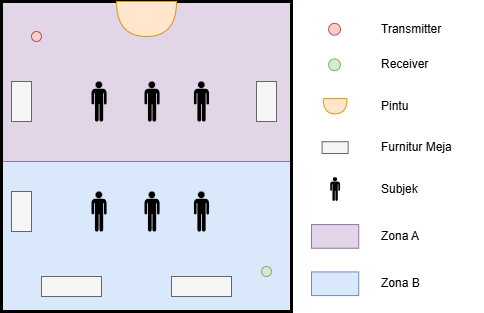
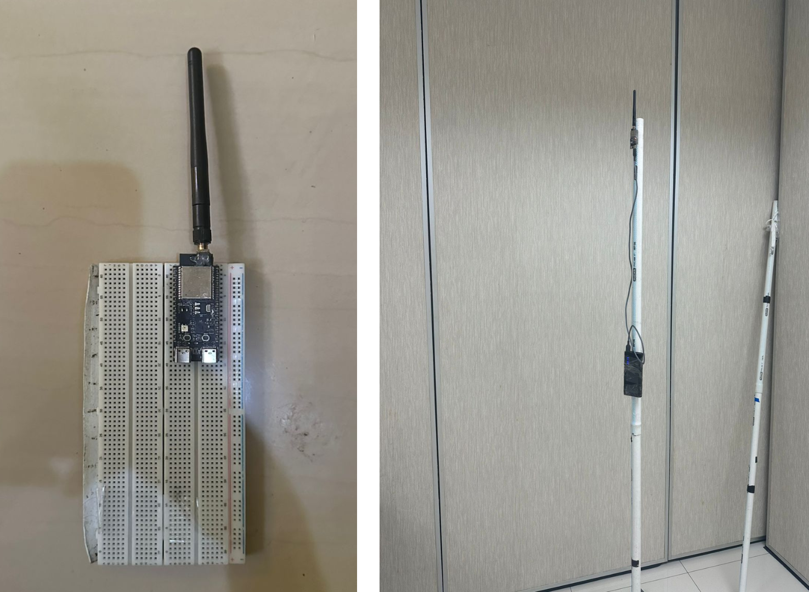

# Firmware pengambilan data CSI: skripsi dan paper conference

[English version](README.en.md)

Firmware dan alat rekam untuk mengumpulkan Channel State Information (CSI) Wi-Fi 6 dengan dua ESP32-C6. Data ini dipakai untuk estimasi jumlah orang di dalam ruangan, dari 0 sampai 6 orang.

Metode akuisisinya **UART (v2)**: receiver mengirim CSI lewat UART ke PC, lalu skrip Python menyimpannya sebagai file `.bin`.

## Isi folder

```text
firmware-skripsi-conference/
├── transmitter/                 Proyek ESP-IDF pemancar ESP-NOW 100 Hz
├── receiver/                    Proyek ESP-IDF penerima CSI, stream biner lewat UART
├── tools/
│   ├── csi_uart_capture.py      Merekam stream UART ke file .bin
│   └── csi_bin_to_csv.py        Mengubah file .bin ke .csv
└── docs/                        Gambar tata letak dan perangkat
```

## Cara kerja

```text
Transmitter ── ESP-NOW broadcast, 100 Hz ──> Receiver ── UART 921600 ──> USB-TTL ──> PC
```

1. Transmitter mengirim penghitung 4 byte ke alamat broadcast tiap 10 ms.
2. Receiver menangkap CSI dari setiap paket yang berasal dari MAC transmitter.
3. Receiver menyusun header 28 byte dan 512 nilai CSI, lalu menulisnya ke UART0.
4. Tiap ±1 detik receiver menyisipkan magic `0xDEADBEEF` sebagai penanda sinkronisasi.
5. `csi_uart_capture.py` menunggu magic pertama, lalu menyimpan semua byte ke file.

## Kebutuhan

### Perangkat keras

| Barang | Jumlah | Catatan |
|---|---|---|
| ESP32-C6-DevKitC-1-N8 | 2 | Satu transmitter, satu receiver |
| Antena omnidirectional 2,4 GHz 3 dBi | 2 | Antena eksternal, menggantikan antena PCB bawaan |
| Adapter USB-TTL | 1 | Logika 3,3 V, mendukung 921600 baud |
| Power bank | 2 | Sumber daya kedua board |
| Tiang penyangga 2 m | 2 | Satu per board |
| PC | 1 | Menjalankan perekam |

### Perangkat lunak

- ESP-IDF 5.5.2
- Python 3 dan pyserial

```bash
pip install pyserial
```

Komponen `esp_csi_gain_ctrl` diunduh otomatis saat build pertama, jadi build pertama butuh internet. Versinya terkunci di `dependencies.lock`.

## Konfigurasi radio

| Parameter | Nilai |
|---|---|
| Target | ESP32-C6 |
| Kanal, bandwidth | 11 (2,4 GHz), 20 MHz |
| Protokol | IEEE 802.11ax, ESP-NOW HE20, MCS0 long GI |
| Laju kirim | 100 paket per detik |
| Tujuan | Broadcast `ff:ff:ff:ff:ff:ff` |
| MAC transmitter | `1a:00:00:00:00:00` |
| Daya pancar | Nilai 84 (21 dBm) |
| Mode CSI | HE SU, 256 subcarrier, 242 aktif |
| UART | UART0, GPIO16/17, 921600 baud, 8N1 |

## Build dan flash

Aktifkan environment ESP-IDF terlebih dahulu.

```powershell
. C:\esp\v5.5.2\esp-idf\export.ps1
```

Jalankan perintah berikut di folder `transmitter`, lalu ulangi di folder `receiver`. Ganti `COM5` dengan port board.

```bash
idf.py set-target esp32c6
```

```bash
idf.py build
```

```bash
idf.py -p COM5 flash
```

Kedua proyek sudah diuji build dari keadaan bersih pada ESP-IDF 5.5.2. Hasil build ini belum diuji ulang di perangkat.

### Memeriksa transmitter

```bash
idf.py -p COM5 monitor
```

Transmitter yang sehat mencetak `===== ESP-NOW Broadcast Only =====`, lalu `Last sent id: <angka>` tiap detik.

Receiver tidak mencetak log sama sekali. Firmware mematikan log karena UART dipakai untuk data biner, jadi periksa receiver lewat perekam.

## Merangkai receiver

| Adapter USB-TTL | ESP32-C6 (receiver) |
|---|---|
| RXD | GPIO16 |
| TXD | GPIO17 (opsional, receiver tidak menerima perintah) |
| GND | GND |

Pin VCC adapter tidak perlu disambung, karena board mendapat daya dari power bank.

Stream keluar dari GPIO16, bukan dari port USB-JTAG board. Merekam dari port USB-JTAG akan menghasilkan 0 byte.

## Menempatkan perangkat



- Ruangan berukuran 7 × 9 m, dibagi sepanjang sisi 9 m menjadi Zona A dan Zona B, masing-masing 7 × 4,5 m.
- Kedua zona berisi meja sebagai furnitur.
- Transmitter berada di sudut kiri atas Zona A.
- Receiver berada di sudut kanan bawah Zona B.
- Jarak keduanya sekitar 10–11 m secara diagonal.
- Kedua board dipasang di atas tiang setinggi 2 m.



## Protokol pengambilan data

Pengambilan data melibatkan 6 orang, yaitu peneliti dan 5 relawan. Setiap subjek tetap berada di dalam zona yang ditentukan selama perekaman.

### Kelas 0: ruangan kosong

Rekam 3 menit tanpa subjek, dalam empat konfigurasi furnitur:

1. Tanpa kursi
2. 2 kursi
3. 4 kursi
4. 8 kursi

### Kelas 1 sampai 6

Setiap kelas dengan n orang direkam dalam semua distribusi zona: hanya Zona A, hanya Zona B, dan semua kombinasi lintas zona. Setiap distribusi direkam dalam dua skenario.

| Skenario | Durasi | Menit 1 | Menit 2 | Menit 3 |
|---|---|---|---|---|
| `Berdiri_Aktivitas` | 3 menit | Semua berdiri diam | Setengah subjek berjalan acak di zonanya, sisanya berdiri diam | Semua berjalan acak di zonanya |
| `Duduk_Cluster` | 2 menit | Semua duduk tersebar di zonanya | Semua duduk berkumpul di tengah zonanya | Tidak ada |

### Jumlah rekaman

| Kelas | Variasi | Jumlah file |
|---|---|---|
| 0 | 4 konfigurasi furnitur | 4 |
| 1 | A, B | 4 |
| 2 | A, B, AB 1-1 | 6 |
| 3 | A, B, AB 1-2, 2-1 | 8 |
| 4 | A, B, AB 1-3, 2-2, 3-1 | 10 |
| 5 | A, B, AB 1-4, 2-3, 3-2, 4-1 | 12 |
| 6 | A, B, AB 1-5, 2-4, 3-3, 4-2, 5-1 | 14 |
| **Total** | | **58** |

### Penamaan file

| Pola | Arti | Contoh |
|---|---|---|
| `0orang_<a-d>.bin` | Ruangan kosong | `0orang_a.bin` |
| `A_<n>orang_<skenario>.bin` | n orang di Zona A | `A_3orang_Berdiri_Aktivitas.bin` |
| `B_<n>orang_<skenario>.bin` | n orang di Zona B | `B_2orang_Duduk_Cluster.bin` |
| `AB_<x>-<y>orang_<skenario>.bin` | x orang di Zona A, y orang di Zona B | `AB_2-1orang_Berdiri_Aktivitas.bin` |

Label diambil dari nama file, jadi nama yang salah menghasilkan label yang salah.

## Langkah perekaman

### Sebelum sesi

1. Pasang kedua board di tiang pada posisinya.
2. Nyalakan transmitter dari power bank. Biarkan menyala sepanjang sesi.
3. Nyalakan receiver dari power bank, lalu sambungkan adapter USB-TTL ke PC.
4. Cari nama port adapter, misalnya `COM7` di Windows atau `/dev/ttyUSB0` di Linux.
5. Buat folder hasil rekaman di folder ini.

```bash
mkdir captures
```

6. Rekam uji selama 10 detik, lalu periksa sesuai bagian [Memeriksa hasil rekaman](#memeriksa-hasil-rekaman).

```bash
python tools/csi_uart_capture.py COM7 -b 921600 -o captures/uji.bin --duration 10
```

### Setiap rekaman

1. Atur furnitur dan posisi subjek sesuai kelas, zona, dan skenario.
2. Jalankan perekam dengan nama file sesuai format.

```bash
python tools/csi_uart_capture.py COM7 -b 921600 -o captures/A_2orang_Berdiri_Aktivitas.bin --duration 200
```

3. Pastikan log bertambah sekitar 92 KB tiap detik.

```text
saved=92160 bytes | elapsed=1.0s
saved=184320 bytes | elapsed=2.0s
```

4. Pandu pergantian fase tiap menit sesuai skenario.
5. Perekam berhenti sendiri setelah `--duration`. Rekaman juga bisa dihentikan dengan `Ctrl+C`.
6. Periksa file, lalu lanjut ke rekaman berikutnya.

Teks boot receiver sebelum magic pertama otomatis dibuang oleh perekam.

### Memilih durasi

Parser pelatihan membuang 500 paket di awal dan 500 paket di akhir rekaman, sekitar 6 detik di masing-masing sisi. Beri margin agar fase skenario tidak ikut terbuang.

| Rekaman | Durasi skenario | `--duration` yang disarankan |
|---|---|---|
| Kelas 0 | 180 detik | 190 |
| `Berdiri_Aktivitas` | 180 detik | 200 |
| `Duduk_Cluster` | 120 detik | 150 |

Saran ini mengikuti nilai tengah dataset. Perekaman dulu dimulai dan dihentikan secara manual, jadi durasi file di dataset bervariasi: kelas 0 sekitar 179–189 detik, `Berdiri_Aktivitas` 136–221 detik, dan `Duduk_Cluster` 121–199 detik.

## Memeriksa hasil rekaman

```bash
python tools/csi_bin_to_csv.py captures/A_2orang_Berdiri_Aktivitas.bin
```

Perintah ini membuat file `.csv` di sebelah file `.bin`, lalu mencetak ringkasan seperti `Done. rows=15676, magic=173, bad_records=0`.

| Kolom | Nilai yang diharapkan |
|---|---|
| `tx_id` | 4 |
| `mac` | `1a:00:00:00:00:00` |
| `channel` | 11 |
| `len` | 512 |
| `sig_len` | 47 |

Jumlah baris sekitar 87,5 per detik, dan magic sekitar 1 per detik. `bad_records` idealnya 0.

### Kalau ada masalah

| Gejala | Kemungkinan penyebab | Yang dicek |
|---|---|---|
| Log tetap `saved=0` | Stream tidak sampai ke PC | Sambungan GPIO16 ke RXD, GND, port, dan baud |
| Log tetap `saved=0` | Port yang dibuka adalah USB-JTAG board | Pakai port adapter USB-TTL |
| Log bertambah jauh di bawah 92 KB per detik | Transmitter mati atau jauh | Monitor transmitter, posisi antena, dan kanal |
| `Missing dependency: pyserial` | pyserial belum terpasang | Jalankan `pip install pyserial` |
| `Failed to open serial port` | Port salah atau sedang dipakai | Tutup monitor serial lain |
| `No such file or directory` | Folder tujuan belum ada | Buat folder `captures` |

## Format file `.bin`

File berisi rangkaian frame, little-endian dan packed. Magic `0xDEADBEEF` muncul di antara frame sekitar tiap detik.

| Offset | Tipe | Field | Keterangan |
|---|---|---|---|
| 0 | `uint32` | `msg_id` | Penghitung dari transmitter |
| 4 | `uint8` | `tx_id` | Identitas node receiver, selalu 4 |
| 5 | `int16` | `rssi` | RSSI (dBm) |
| 7 | `uint8` | `rate` | Nilai rate dari driver |
| 8 | `int8` | `noise_floor` | Noise floor |
| 9 | `int8` | `fft_gain` | Gain FFT |
| 10 | `uint8` | `agc_gain` | Gain AGC |
| 11 | `uint8` | `channel` | Kanal Wi-Fi |
| 12 | `uint8` | `first_word_invalid` | Penanda dari driver |
| 13 | `uint8[6]` | `mac` | MAC pengirim |
| 19 | `uint32` | `timestamp` | Timestamp penerima (µs) |
| 23 | `uint16` | `sig_len` | Panjang paket |
| 25 | `uint8` | `rx_state` | Status penerimaan |
| 26 | `uint16` | `len` | Jumlah nilai CSI |
| 28 | `int16[len]` | `csi` | Data CSI |

Format struct Python untuk header:

```python
HEADER = struct.Struct("<I B h B b b B B B 6s I H B H")
```

Nilai CSI berjumlah 512, yaitu 256 subcarrier dengan dua nilai per subcarrier. Dokumentasi ESP-IDF 5.5.2 tidak menyatakan urutan pasangan ini untuk ESP32-C6. Untuk chip lain seperti ESP32-C5, urutannya bagian imajiner lalu bagian real. Magnitudo tidak terpengaruh, tapi fase bisa berbeda.

Indeks subcarrier `0–5`, `127–129`, dan `251–255` tidak aktif, sehingga tersisa 242 subcarrier aktif.

## Hal yang perlu diketahui

- **Laju terima lebih rendah dari laju kirim.** UART 921600 baud 8N1 membawa 92.160 byte per detik, dan satu paket berukuran 1.052 byte. Batasnya 87,6 paket per detik, jadi sekitar 12% paket terbuang di receiver. Paket yang terbuang terlihat sebagai loncatan `msg_id`.
- **100 sampel tidak selalu sama dengan 1 detik.** Pada 87,5 Hz, 100 sampel setara sekitar 1,14 detik.
- **Dataset publik terbagi dua kelompok file.** Sebanyak 20 file `.bin` memiliki laju terima sekitar 87,5 Hz, dan 38 file `.BIN` sekitar 99,7 Hz. Konfigurasi di folder ini menghasilkan ciri kelompok pertama.
- **Nilai CSI mentah.** Firmware tidak mengompensasi gain dan AGC berjalan bebas. Nilai `agc_gain` dan `fft_gain` disimpan per paket.
- **Paket rusak bisa terjadi.** Byte yang hilang di UART bisa membuat parser membaca paket palsu. Saring paket dengan `len == 512` dan `channel == 11`.
- **Nama `CONFIG_TX_ID` menyesatkan.** Konstanta di `receiver/main/app_main.c` ini adalah identitas node receiver.

## Dataset

Dataset terbit di Zenodo: [10.5281/zenodo.21467952](https://doi.org/10.5281/zenodo.21467952).

## Asal kode

Firmware dikembangkan dari contoh `get-started` pada [esp-csi](https://github.com/espressif/esp-csi) milik Espressif, yang berlisensi Apache-2.0.
